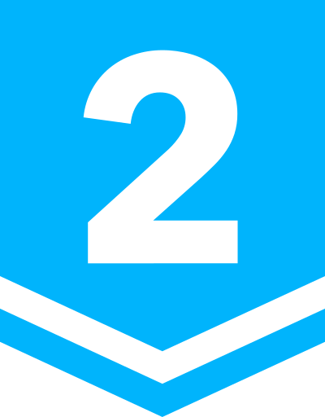
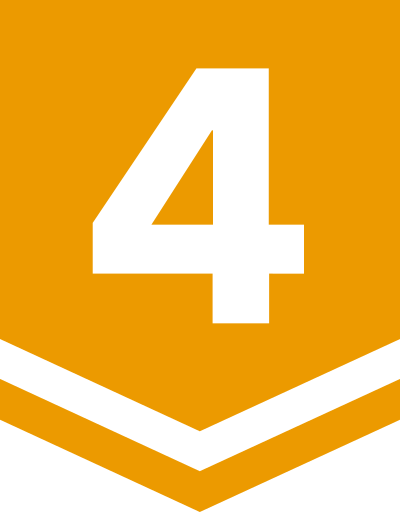

# 🏆 재밌었던 문제들 1 + 재밌었던 DP 모음

[재밌었던 문제들 1](https://www.acmicpc.net/workbook/view/15194) + [재밌었던 DP 모음](https://www.acmicpc.net/workbook/view/19590) 문제 풀이 및 진행 현황

## 📊 Progress

- **진행도:** 114 / 174 (65.52%)
- **마지막 업데이트:** 2026-08-28

---

| No. | Difficulty | Title | Problem Link | Source Code |
| :---: | :---: | :--- | :--- | :---: |
| 1 |  | [팰린드롬의 개수](https://acmicpc.net/problem/1204) | https://archive.topcoder.com/ProblemStatement/pm/7418 | [source code](./count-palindromes/main.cpp) |
| 2 |  | [1 또는 -1](https://acmicpc.net/problem/1635) | - | [source code](./one-or-minus-one/main.cpp) |
| 3 |  | [팰린드롬 인코딩](https://acmicpc.net/problem/1784) | https://archive.topcoder.com/ProblemStatement/pm/6766 | [source code](./palindrome-encoding/main.cpp) |
| 4 |  | [랩싸기](https://acmicpc.net/problem/1804) | https://www.spoj.com/problems/LAZYCOWS/en/ | [source code](./lazy-cows/main.cpp) |
| 5 |  | [두 수열](https://acmicpc.net/problem/2192) | https://www.luogu.com.cn/problem/P1846 | [source code](./two-sequences/main.cpp) |
| 6 |  | [트리 만들기](https://acmicpc.net/problem/2255) | - | [source code](./making-tree/main.cpp) |
| 7 |  | [거울2](https://acmicpc.net/problem/2347) | https://dmoj.ca/problem/btoi01p3 | |
| 8 |  | [신호 장애](https://acmicpc.net/problem/2431) | https://qoj.ac/problem/16241 | [source code](./signal-interference/main.cpp) |
| 9 |  | [초고속철도](https://acmicpc.net/problem/2543) | https://jungol.co.kr/problem/1479 | [source code](./high-speed-rail/main.cpp) |
| 10 |  | [2,3 거듭제곱의 합](https://acmicpc.net/problem/2727) | https://qoj.ac/problem/1473 | [source code](./sum-of-powers-of-2-3/main.cpp) |
| 11 |  | [K-Graph Oddity](https://acmicpc.net/problem/3528) | https://codeforces.com/gym/101309 | [source code](./k-graph-oddity/main.cpp) |
| 12 |  | [텔레점프](https://acmicpc.net/problem/3999) | https://codeforces.com/gym/100134 | [source code](./jumping-around/main.cpp) |
| 13 |  | [Teleporters](https://acmicpc.net/problem/5472) | https://qoj.ac/problem/12666 | |
| 14 |  | [마라톤 훈련 방해하기](https://acmicpc.net/problem/5477) | https://qoj.ac/problem/13044 | |
| 15 |  | [Hermes](https://acmicpc.net/problem/5492) | https://qoj.ac/problem/13803 | [source code](./hermes/main.cpp) |
| 16 |  | [Utopia Divided](https://acmicpc.net/problem/5496) | https://qoj.ac/problem/13815 | |
| 17 |  | [お土産購入計画 (Gifts)](https://acmicpc.net/problem/5537) | https://atcoder.jp/contests/joi2013yo/tasks/joi2013yo_f | [source code](./gifts/main.cpp) |
| 18 |  | [JOI 깃발](https://acmicpc.net/problem/5559) | https://atcoder.jp/contests/joi2011yo/tasks/joi2011yo_f | [source code](./joi-flag/main.cpp) |
| 19 |  | [博覧会](https://acmicpc.net/problem/5563) | https://atcoder.jp/contests/joi2010ho/tasks/joi2010ho_d | [source code](./exhibition/main.cpp) |
| 20 |  | [ダンジョン](https://acmicpc.net/problem/5564) | https://atcoder.jp/contests/joi2010ho/tasks/joi2010ho_e | |
| 21 |  | [Mountain Climbing](https://acmicpc.net/problem/5910) | https://usaco.org/index.php?page=viewproblem2&cpid=108 | [source code](./mountain-climbing/main.cpp) |
| 22 |  | [바이너리 스도쿠](https://acmicpc.net/problem/5923) | https://usaco.org/index.php?page=viewproblem2&cpid=92 | [source code](./binary-sudoku/main.cpp) |
| 23 |  | [식당](https://acmicpc.net/problem/6101) | https://www.luogu.com.cn/problem/P2943 | [source code](./cleaning-up/main.cpp) |
| 24 |  | [Watching](https://acmicpc.net/problem/7611) | https://qoj.ac/problem/12900 | [source code](./watching/main.cpp) |
| 25 |  | [무한 게임](https://acmicpc.net/problem/7623) | - | |
| 26 |  | [두 교수](https://acmicpc.net/problem/7888) | https://www.spoj.com/problems/TWOPROF/en/ | |
| 27 |  | [장비를 정지합니다](https://acmicpc.net/problem/7981) | https://qoj.ac/problem/11576 | [source code](./hydra/main.cpp) |
| 28 |  | [Hamsters](https://acmicpc.net/problem/8190) | https://qoj.ac/problem/571 | [source code](./hamsters/main.cpp) |
| 29 |  | [Lollipop](https://acmicpc.net/problem/8203) | https://qoj.ac/problem/9509 | [source code](./lollipop/main.cpp) |
| 30 |  | [Cloakroom](https://acmicpc.net/problem/8227) | https://qoj.ac/problem/13302 | [source code](./cloakroom/main.cpp) |
| 31 |  | [Red John Game](https://acmicpc.net/problem/9270) | https://qoj.ac/problem/15747 | [source code](./red-john-game/main.cpp) |
| 32 |  | [小籠包 (Xiao Long Bao)](https://acmicpc.net/problem/10044) | https://atcoder.jp/contests/joi2014yo/tasks/joi2014yo_f | [source code](./xiao-long-bao/main.cpp) |
| 33 |  | [Computer Network](https://acmicpc.net/problem/10094) | - | [source code](./computer-network/main.cpp) |
| 34 |  | [Lazy Fox](https://acmicpc.net/problem/10108) | https://dmoj.ca/problem/ccc14s5 | [source code](./lazy-fox/main.cpp) |
| 35 |  | [Spy Network](https://acmicpc.net/problem/10287) | - | [source code](./spy-network/main.cpp) |
| 36 |  | [만칼라](https://acmicpc.net/problem/10435) | https://qoj.ac/problem/5621 | [source code](./mancala/main.cpp) |
| 37 |  | [바이너리 게임](https://acmicpc.net/problem/11565) | https://codeforces.com/contest/297/problem/A | [source code](./binary-game/main.cpp) |
| 38 |  | [Bank](https://acmicpc.net/problem/11855) | https://oj.uz/problem/view/IZhO14_bank | [source code](./bank/main.cpp) |
| 39 |  | [K blocks](https://acmicpc.net/problem/11858) | https://oj.uz/problem/view/IZhO14_blocks | [source code](./k-blocks/main.cpp) |
| 40 |  | [괄호 채우기](https://acmicpc.net/problem/11882) | https://codeforces.com/contest/3/problem/D | [source code](./filling-brackets/main.cpp) |
| 41 |  | [핀볼](https://acmicpc.net/problem/11941) | https://oj.uz/problem/view/JOI14_pinball | [source code](./pinball/main.cpp) |
| 42 |  | [쇼핑](https://acmicpc.net/problem/11953) | https://atcoder.jp/contests/joi2016yo/tasks/joi2016yo_f | [source code](./shopping/main.cpp) |
| 43 |  | [262144](https://acmicpc.net/problem/12008) | https://www.luogu.com.cn/problem/P3147 | [source code](./262144/main.cpp) |
| 44 |  | [Candy Store](https://acmicpc.net/problem/12548) | https://qoj.ac/problem/5850 | [source code](./candy-store/main.cpp) |
| 45 |  | [Modern Art Plagiarism](https://acmicpc.net/problem/12694) | https://qoj.ac/problem/5774 | [source code](./modern-art-plagiarism/main.cpp) |
| 46 |  | [Boat](https://acmicpc.net/problem/12735) | https://qoj.ac/problem/2 | |
| 47 |  | [Balanced Diet](https://acmicpc.net/problem/12765) | https://qoj.ac/problem/4362 | |
| 48 |  | [Fox and Card Game](https://acmicpc.net/problem/12885) | https://codeforces.com/contest/388/problem/C | [source code](./fox-and-card-game/main.cpp) |
| 49 |  | [별 모으기](https://acmicpc.net/problem/12923) | https://qoj.ac/contest/1173/problem/5885 | [source code](./kingdom-rush/main.cpp) |
| 50 |  | [Popeala](https://acmicpc.net/problem/13191) | https://qoj.ac/problem/5535 | [source code](./popeala/main.cpp) |
| 51 |  | [Skinny Polygon](https://acmicpc.net/problem/13407) | https://qoj.ac/problem/181 | |
| 52 |  | [Windy Path](https://acmicpc.net/problem/13740) | https://codeforces.com/gym/101201 | [source code](./windy-path/main.cpp) |
| 53 |  | [조개 줍기](https://acmicpc.net/problem/14870) | https://jungol.co.kr/problem/3081 | [source code](./shell-collecting/main.cpp) |
| 54 |  | [森林伐採 (Deforestation)](https://acmicpc.net/problem/15478) | https://atcoder.jp/contests/joi2018yo/tasks/joi2018_yo_e | [source code](./deforestation/main.cpp) |
| 55 |  | [Dango Maker](https://acmicpc.net/problem/15555) | https://qoj.ac/problem/3125 | [source code](./dango-maker/main.cpp) |
| 56 |  | [Commuter Pass](https://acmicpc.net/problem/15556) | https://qoj.ac/problem/3126 | [source code](./commuter-pass/main.cpp) |
| 57 |  | [Talent Show](https://acmicpc.net/problem/15759) | https://usaco.org/index.php?page=viewproblem2&cpid=839 | [source code](./talent-show/main.cpp) |
| 58 |  | [Split and Merge](https://acmicpc.net/problem/15902) | - | [source code](./split-and-merge/main.cpp) |
| 59 |  | [Balanced Trees](https://acmicpc.net/problem/16024) | https://dmoj.ca/problem/ccc18s4 | [source code](./balanced-trees/main.cpp) |
| 60 |  | [게임이론](https://acmicpc.net/problem/16142) | - | |
| 61 |  | [Min Max Convert](https://acmicpc.net/problem/16331) | https://qoj.ac/problem/2387 | [source code](./min-max-convert/main.cpp) |
| 62 |  | [Chemical table](https://acmicpc.net/problem/16372) | https://qoj.ac/problem/326 | [source code](./chemical-table/main.cpp) |
| 63 |  | [Nim without Zero](https://acmicpc.net/problem/16831) | https://atcoder.jp/contests/jag2018summer-day3/tasks/jag2018summer_day3_f | [source code](./nim-without-zero/main.cpp) |
| 64 |  | [Growing Vegetables is Fun 3](https://acmicpc.net/problem/16982) | https://qoj.ac/problem/2764 | |
| 65 |  | [Moorio Kart](https://acmicpc.net/problem/17031) | https://qoj.ac/problem/1802 | |
| 66 |  | [Mobitel](https://acmicpc.net/problem/17056) | https://qoj.ac/problem/13592 | |
| 67 |  | [그래서 팩 주냐?](https://acmicpc.net/problem/17227) | - | [source code](./give-me-packs/main.cpp) |
| 68 |  | [Tents](https://acmicpc.net/problem/17682) | https://qoj.ac/problem/116 | [source code](./tents/main.cpp) |
| 69 |  | [Library](https://acmicpc.net/problem/17690) | https://qoj.ac/problem/124 | |
| 70 |  | [Toilets](https://acmicpc.net/problem/17709) | https://qoj.ac/problem/407 | [source code](./toilets/main.cpp) |
| 71 |  | [Card Game Is Great Fun](https://acmicpc.net/problem/17724) | https://qoj.ac/problem/1211 | [source code](./card-game-is-great-fun/main.cpp) |
| 72 |  | [Mascots](https://acmicpc.net/problem/17747) | https://qoj.ac/problem/1414 | [source code](./mascots/main.cpp) |
| 73 |  | [Koala](https://acmicpc.net/problem/17750) | https://qoj.ac/problem/1417 | [source code](./koala/main.cpp) |
| 74 |  | [Kangaroo](https://acmicpc.net/problem/17774) | https://qoj.ac/problem/12615 | [source code](./kangaroo/main.cpp) |
| 75 |  | [Inquiry II](https://acmicpc.net/problem/17790) | https://qoj.ac/problem/6261 | [source code](./inquiry/main.cpp) |
| 76 |  | [Level Up](https://acmicpc.net/problem/17956) | https://qoj.ac/problem/2372 | [source code](./level-up/main.cpp) |
| 77 |  | [Find the Array](https://acmicpc.net/problem/17957) | https://qoj.ac/problem/2373 | |
| 78 |  | [Ladder Game](https://acmicpc.net/problem/17971) | https://qoj.ac/problem/10949 | |
| 79 |  | [Disposable Switches](https://acmicpc.net/problem/18083) | https://qoj.ac/problem/2413 | |
| 80 |  | [Reordering the Documents](https://acmicpc.net/problem/18214) | https://qoj.ac/problem/1191 | [source code](./reordering-the-documents/main.cpp) |
| 81 |  | [Cool Pairs](https://acmicpc.net/problem/18449) | https://qoj.ac/problem/12213 | [source code](./cool-pairs/main.cpp) |
| 82 |  | [Best Tree](https://acmicpc.net/problem/18459) | https://qoj.ac/problem/832 | [source code](./best-tree/main.cpp) |
| 83 |  | [Eight Sins](https://acmicpc.net/problem/18484) | https://qoj.ac/problem/12318 | [source code](./eight-sins/main.cpp) |
| 84 |  | [Greedy Algorithm](https://acmicpc.net/problem/18495) | https://qoj.ac/problem/1461 | [source code](./greedy-algorithm/main.cpp) |
| 85 |  | [Delegation](https://acmicpc.net/problem/18777) | https://qoj.ac/problem/1992 | |
| 86 |  | [Building 4](https://acmicpc.net/problem/18839) | https://qoj.ac/problem/3552 | [source code](./building-4/main.cpp) |
| 87 |  | [Exercise](https://acmicpc.net/problem/18876) | https://qoj.ac/problem/1996 | [source code](./exercise/main.cpp) |
| 88 |  | [Balanced Sequence](https://acmicpc.net/problem/18978) | https://qoj.ac/problem/236 | [source code](./balanced-sequence/main.cpp) |
| 89 |  | [Compressed Spanning Subtrees](https://acmicpc.net/problem/19331) | https://qoj.ac/problem/11743 | |
| 90 |  | [소가 길을 건너간 이유 2020](https://acmicpc.net/problem/19545) | - | |
| 91 |  | [Ancient Books](https://acmicpc.net/problem/20081) | https://qoj.ac/problem/2761 | |
| 92 |  | [Martian DNA](https://acmicpc.net/problem/20084) | https://qoj.ac/problem/40 | |
| 93 |  | [Cup of Jamshid](https://acmicpc.net/problem/20092) | https://oj.uz/problem/view/IOI17_cup | [source code](./cup-of-jamshid/main.cpp) |
| 94 |  | [Human Pyramid](https://acmicpc.net/problem/20220) | - | [source code](./human-pyramid/main.cpp) |
| 95 |  | [Xortest Path](https://acmicpc.net/problem/20349) | https://qoj.ac/problem/877 | [source code](./xortest-path/main.cpp) |
| 96 |  | [Hop](https://acmicpc.net/problem/20662) | https://qoj.ac/problem/13412 | |
| 97 |  | [Rymdpromenad](https://acmicpc.net/problem/20876) | https://github.com/Kodsport/swedish-olympiad-2018/tree/master/lager/rymdpromenad | [source code](./rymdpromenad/main.cpp) |
| 98 |  | [イベント巡り (Event Hopping)](https://acmicpc.net/problem/20981) | https://atcoder.jp/contests/joi2021yo2/tasks/joi2021_yo2_c | |
| 99 |  | [Group Photo](https://acmicpc.net/problem/20986) | https://qoj.ac/problem/2177 | |
| 100 |  | [Thanks to MikeMirzayanov](https://acmicpc.net/problem/21087) | https://qoj.ac/problem/962 | |
| 101 |  | [Increasing or Decreasing](https://acmicpc.net/problem/21091) | https://qoj.ac/problem/966 | [source code](./increasing-or-decreasing/main.cpp) |
| 102 |  | [Permutation](https://acmicpc.net/problem/21816) | https://usaco.org/index.php?page=viewproblem2&cpid=1139 | |
| 103 |  | [Reverse Game](https://acmicpc.net/problem/21906) | https://qoj.ac/problem/1644 | [source code](./reverse-game/main.cpp) |
| 104 |  | [헬기 착륙장](https://acmicpc.net/problem/22348) | https://jungol.co.kr/problem/4806 | [source code](./helipad/main.cpp) |
| 105 |  | [돌 가져가기](https://acmicpc.net/problem/22354) | https://qoj.ac/problem/18488 | |
| 106 |  | [Rabbit Jumping](https://acmicpc.net/problem/22593) | https://judge.u-aizu.ac.jp/onlinejudge/description.jsp?id=2384 | |
| 107 |  | [나의 라임 오렌지 나무](https://acmicpc.net/problem/22900) | - | [source code](./my-orange-tree/main.cpp) |
| 108 |  | [Hidden Pancakes](https://acmicpc.net/problem/22911) | https://qoj.ac/problem/12460 | [source code](./hidden-pancakes/main.cpp) |
| 109 |  | [달팽이는 그늘에서 쉬고 싶다](https://acmicpc.net/problem/22977) | - | [source code](./snail-wants-to-rest/main.cpp) |
| 110 |  | [Secret Sequence](https://acmicpc.net/problem/23072) | https://scc21.kattis.com/contests/scc21/problems/secretsequence | [source code](./secret-sequence/main.cpp) |
| 111 |  | [King](https://acmicpc.net/problem/23458) | https://qoj.ac/problem/5045 | [source code](./king/main.cpp) |
| 112 |  | [Misunderstood Missing](https://acmicpc.net/problem/23668) | https://qoj.ac/problem/10210 | |
| 113 |  | [Vertex Merge Game](https://acmicpc.net/problem/23736) | - | |
| 114 |  | [Leader-based Team Distribution](https://acmicpc.net/problem/23750) | - | |
| 115 |  | [카드컨트롤 (Hard)](https://acmicpc.net/problem/23755) | - | [source code](./card-control-hard/main.cpp) |
| 116 |  | [괄호 문자열 이동하기](https://acmicpc.net/problem/23763) | - | [source code](./moving-brackets/main.cpp) |
| 117 |  | [Paired Up](https://acmicpc.net/problem/23872) | https://qoj.ac/problem/2152 | [source code](./paired-up/main.cpp) |
| 118 |  | [Energy Stones](https://acmicpc.net/problem/23933) | https://www.luogu.com.cn/problem/U291800 | |
| 119 |  | [XCopy](https://acmicpc.net/problem/24068) | https://qoj.ac/problem/8098 | |
| 120 |  | [解読 (Deciphering)](https://acmicpc.net/problem/24099) | https://atcoder.jp/contests/joisc2011/tasks/joisc2011_deciphering | [source code](./deciphering/main.cpp) |
| 121 |  | [誘拐 (Abduction)](https://acmicpc.net/problem/24130) | https://atcoder.jp/contests/joisc2009/tasks/joisc2009_abduction | [source code](./abduction/main.cpp) |
| 122 |  | [Let’s Win the Election](https://acmicpc.net/problem/24476) | https://qoj.ac/problem/2629 | |
| 123 |  | [Drought](https://acmicpc.net/problem/24488) | https://usaco.org/index.php?page=viewproblem2&cpid=1185 | |
| 124 |  | [단어의 개수](https://acmicpc.net/problem/24528) | - | [source code](./count-words/main.cpp) |
| 125 |  | [이야기 배열](https://acmicpc.net/problem/24529) | - | [source code](./story-array/main.cpp) |
| 126 |  | [Coins and Boxes](https://acmicpc.net/problem/24655) | https://qoj.ac/problem/2541 | [source code](./coins-and-boxes/main.cpp) |
| 127 |  | [Animal Observation (hard version)](https://acmicpc.net/problem/24837) | https://codeforces.com/contest/1304/problem/F2 | [source code](./animal-observation-hard/main.cpp) |
| 128 |  | [Copy and Paste 3](https://acmicpc.net/problem/24945) | https://qoj.ac/problem/3504 | |
| 129 |  | [Il Derby della Madonnina](https://acmicpc.net/problem/25055) | https://qoj.ac/problem/3861 | |
| 130 |  | [GCD Harmony](https://acmicpc.net/problem/25229) | https://qoj.ac/problem/4229 | |
| 131 |  | [편지 배달](https://acmicpc.net/problem/25322) | - | |
| 132 |  | [수 정렬하기, 근데 이제 제곱수를 곁들인](https://acmicpc.net/problem/25323) | - | [source code](./sort-with-squares/main.cpp) |
| 133 |  | [니은숲 예술가](https://acmicpc.net/problem/25384) | https://qoj.ac/problem/16888 | [source code](./nieun-forest-artist/main.cpp) |
| 134 |  | [대충 카드로 몬스터 잡는 게임](https://acmicpc.net/problem/25389) | https://qoj.ac/problem/16893 | [source code](./card-monster-game/main.cpp) |
| 135 |  | [Traveling Junkman Problem](https://acmicpc.net/problem/25390) | https://qoj.ac/problem/16894 | |
| 136 |  | [디지털 회로](https://acmicpc.net/problem/25441) | https://qoj.ac/problem/4564 | |
| 137 |  | [이분 그래프 놀이](https://acmicpc.net/problem/25575) | - | [source code](./bipartite-graph-game/main.cpp) |
| 138 |  | [곰곰이와 테트리스](https://acmicpc.net/problem/26074) | - | [source code](./gomgom-tetris/main.cpp) |
| 139 |  | [곰곰아 선 넘지마](https://acmicpc.net/problem/26075) | - | [source code](./gomgom-dont-cross-the-line/main.cpp) |
| 140 |  | [슈퍼 블랙잭](https://acmicpc.net/problem/26096) | - | |
| 141 |  | [High-quality Tree](https://acmicpc.net/problem/26181) | https://qoj.ac/problem/5157 | [source code](./high-quality-tree/main.cpp) |
| 142 |  | [겨울 숲과 마법 불꽃](https://acmicpc.net/problem/26221) | - | [source code](./winter-forest-magic/main.cpp) |
| 143 |  | [Long Nim](https://acmicpc.net/problem/26249) | https://qoj.ac/problem/18173 | [source code](./long-nim/main.cpp) |
| 144 |  | [Bribing Friends](https://acmicpc.net/problem/26969) | https://www.luogu.com.cn/problem/P8903 | |
| 145 |  | [지뢰 피하기](https://acmicpc.net/problem/27090) | - | |
| 146 |  | [효율적인 애니메이션 감상](https://acmicpc.net/problem/27313) | - | [source code](./efficient-animation/main.cpp) |
| 147 |  | [貨物列車 (Freight Train)](https://acmicpc.net/problem/27338) | https://atcoder.jp/contests/joi2023yo2/tasks/joi2023_yo2_d | [source code](./freight-train/main.cpp) |
| 148 |  | [가난한 고흐와 붓](https://acmicpc.net/problem/27502) | - | [source code](./poor-gogh/main.cpp) |
| 149 |  | [タイピング大会 (Typing Contest)](https://acmicpc.net/problem/27546) | https://atcoder.jp/contests/joig2023-open/tasks/joig2023_f | [source code](./typing-contest/main.cpp) |
| 150 |  | [Spinach Pizza](https://acmicpc.net/problem/27597) | https://qoj.ac/problem/5649 | [source code](./spinach-pizza/main.cpp) |
| 151 |  | [Library game](https://acmicpc.net/problem/27601) | https://qoj.ac/problem/5653 | |
| 152 |  | [Watching Cowflix](https://acmicpc.net/problem/27842) | https://qoj.ac/problem/5659 | |
| 153 |  | [Fertilizing Pastures](https://acmicpc.net/problem/27844) | https://usaco.org/index.php?page=viewproblem2&cpid=1306 | [source code](./fertilizing-pastures/main.cpp) |
| 154 |  | [Singularity of the Nim](https://acmicpc.net/problem/27871) | - | |
| 155 |  | [제곱수 덱 2](https://acmicpc.net/problem/27877) | - | [source code](./square-deck-2/main.cpp) |
| 156 |  | [특별한 숙제 순서 바꾸기](https://acmicpc.net/problem/27894) | - | [source code](./homework-order/main.cpp) |
| 157 |  | [조별 수업](https://acmicpc.net/problem/28243) | - | [source code](./group-study/main.cpp) |
| 158 |  | [재우의 카드깡](https://acmicpc.net/problem/28693) | - | [source code](./jaewoo-cards/main.cpp) |
| 159 |  | [보물 상자](https://acmicpc.net/problem/30109) | - | |
| 160 |  | [Introversion](https://acmicpc.net/problem/30327) | https://qoj.ac/problem/15189 | [source code](./introversion/main.cpp) |
| 161 |  | [Server Overload](https://acmicpc.net/problem/30452) | - | [source code](./server-overload/main.cpp) |
| 162 |  | [Sakura Reflection](https://acmicpc.net/problem/30788) | - | [source code](./sakura-reflection/main.cpp) |
| 163 |  | [M. S. I. S.](https://acmicpc.net/problem/30859) | https://qoj.ac/problem/7952 | [source code](./msis/main.cpp) |
| 164 |  | [Special Numbers](https://acmicpc.net/problem/30861) | https://qoj.ac/problem/7954 | [source code](./special-numbers/main.cpp) |
| 165 |  | [두 팀으로 나누기](https://acmicpc.net/problem/30896) | - | [source code](./split-two-teams/main.cpp) |
| 166 |  | [C.S.G.](https://acmicpc.net/problem/31007) | - | |
| 167 |  | [등수](https://acmicpc.net/problem/31095) | - | |
| 168 |  | [Cloud Retainer's Game](https://acmicpc.net/problem/31183) | https://qoj.ac/problem/6439 | [source code](./cloud-retainers-game/main.cpp) |
| 169 |  | [LR](https://acmicpc.net/problem/31290) | - | |
| 170 |  | [高速道路の通行料金 (Highway Tolls)](https://acmicpc.net/problem/31622) | https://atcoder.jp/contests/joi2024yo2/tasks/joi2024_yo2_e | [source code](./highway-tolls/main.cpp) |
| 171 |  | [名前 (Name)](https://acmicpc.net/problem/31640) | https://atcoder.jp/contests/joig2024-open/tasks/joig2024_e | [source code](./name/main.cpp) |
| 172 |  | [점프](https://acmicpc.net/problem/32383) | - | |
| 173 |  | [Simple Tree Decomposition Problem](https://acmicpc.net/problem/32472) | https://qoj.ac/problem/17885 | |
| 174 |  | [오장원전](https://acmicpc.net/problem/32658) | - | |