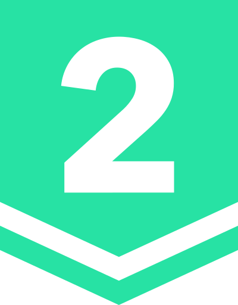

# 🏆 재밌었던 문제들 2 + 재밌었던 문제들 3 + 괜찮았던 DP 모음

[재밌었던 문제들 2](https://www.acmicpc.net/workbook/view/22476) + [재밌었던 문제들 3](https://www.acmicpc.net/workbook/view/23261) + [괜찮았던 DP 모음](https://www.acmicpc.net/workbook/view/24832) 문제 풀이 및 진행 현황

## 📊 Progress

- **진행도:** 7 / 176 (3.98%)
- **마지막 업데이트:** 2026-07-15

---

| No. | Difficulty | Title | Problem Link | Source Code |
| :---: | :---: | :--- | :--- | :---: |
| 1 |  | [이진 수열 회전](https://acmicpc.net/problem/2340) | - | |
| 2 |  | [레스토랑](https://acmicpc.net/problem/2889) | https://qoj.ac/problem/17059 | |
| 3 |  | [혼란](https://acmicpc.net/problem/3037) | https://qoj.ac/problem/17566 | |
| 4 |  | [Driving Exam](https://acmicpc.net/problem/8150) | https://qoj.ac/problem/12698 | |
| 5 |  | [Temperature](https://acmicpc.net/problem/8212) | https://qoj.ac/problem/315 | [source code](./temperature/main.cpp) |
| 6 |  | [Roboty binarne](https://acmicpc.net/problem/8458) | https://szkopul.edu.pl/problemset/problem/o4rf-EbHyBTGgvbEPvm1bH6i/site/?key=statement | |
| 7 |  | [Intercity](https://acmicpc.net/problem/9264) | https://qoj.ac/problem/15741 | [source code](./intercity/main.cpp) |
| 8 |  | [Question](https://acmicpc.net/problem/10117) | https://qoj.ac/problem/13613 | |
| 9 |  | [Self Representing Seq](https://acmicpc.net/problem/10220) | - | |
| 10 |  | [Test Data Analysis](https://acmicpc.net/problem/10221) | - | |
| 11 |  | [STANOVI](https://acmicpc.net/problem/10615) | https://qoj.ac/problem/16379 | |
| 12 |  | [코딩 대회](https://acmicpc.net/problem/10716) | https://atcoder.jp/contests/joi2015ho/tasks/joi2015ho_d | |
| 13 |  | [선물상자](https://acmicpc.net/problem/10919) | https://qoj.ac/problem/2785 | [source code](./boxes-with-souvenirs/main.cpp) |
| 14 |  | [Insider’s Information](https://acmicpc.net/problem/11474) | https://qoj.ac/problem/12743 | |
| 15 |  | [ENDOR](https://acmicpc.net/problem/11814) | https://qoj.ac/problem/13773 | |
| 16 |  | [짝합 수열](https://acmicpc.net/problem/12103) | https://qoj.ac/problem/11571 | [source code](./k-even-sequence/main.cpp) |
| 17 |  | [Merlin QA](https://acmicpc.net/problem/12126) | https://qoj.ac/problem/5985 | |
| 18 |  | [좋아하는 배열](https://acmicpc.net/problem/12911) | https://archive.topcoder.com/ProblemStatement/pm/14186 | |
| 19 |  | [이진 탐색](https://acmicpc.net/problem/13121) | - | |
| 20 |  | [보드 색칠하기](https://acmicpc.net/problem/13444) | https://archive.topcoder.com/ProblemStatement/pm/11534 | |
| 21 |  | [대문자](https://acmicpc.net/problem/13906) | - | |
| 22 |  | [Soldiers](https://acmicpc.net/problem/14313) | - | |
| 23 |  | [수열 순열](https://acmicpc.net/problem/14396) | https://archive.topcoder.com/ProblemStatement/pm/10815 | [source code](./sequence-permutation/main.cpp) |
| 24 |  | [Soccer](https://acmicpc.net/problem/14422) | https://qoj.ac/problem/3144 | |
| 25 |  | [우물](https://acmicpc.net/problem/14432) | - | [source code](./well/main.cpp) |
| 26 |  | [Unbalanced Parentheses](https://acmicpc.net/problem/14516) | https://qoj.ac/problem/6454 | |
| 27 |  | [동전 교환과 쿼리](https://acmicpc.net/problem/14849) | https://onlinejudge.org/index.php?option=com_onlinejudge&Itemid=8&page=show_problem&problem=2226 | [source code](./coin-changing-again/main.cpp) |
| 28 |  | [Mate](https://acmicpc.net/problem/15496) | https://qoj.ac/problem/13698 | [source code](./mate/main.cpp) |
| 29 |  | [Pixel Triangles](https://acmicpc.net/problem/16572) | - | |
| 30 |  | [Eulerian Flight Tour](https://acmicpc.net/problem/16743) | https://qoj.ac/problem/3315 | |
| 31 |  | [Shortcut](https://acmicpc.net/problem/17023) | https://usaco.org/index.php?page=viewproblem2&cpid=899 | |
| 32 |  | [Candy Boxes](https://acmicpc.net/problem/17100) | - | |
| 33 |  | [Pipe Marbles](https://acmicpc.net/problem/17333) | https://dmoj.ca/problem/noi09p5 | |
| 34 |  | [Dangerous Skating](https://acmicpc.net/problem/17713) | https://qoj.ac/problem/411 | |
| 35 |  | [Conveyor Belts](https://acmicpc.net/problem/17784) | https://qoj.ac/problem/6255 | |
| 36 |  | [Cheese Game](https://acmicpc.net/problem/18049) | https://qoj.ac/problem/3032 | |
| 37 |  | [Time is Mooney](https://acmicpc.net/problem/18316) | https://usaco.org/index.php?page=viewproblem2&cpid=993 | |
| 38 |  | [Car washes](https://acmicpc.net/problem/18366) | https://qoj.ac/problem/10714 | |
| 39 |  | [Two Teams](https://acmicpc.net/problem/18475) | https://qoj.ac/problem/12312 | |
| 40 |  | [Six Words](https://acmicpc.net/problem/18482) | https://qoj.ac/problem/12316 | |
| 41 |  | [Nine Judges](https://acmicpc.net/problem/18485) | https://qoj.ac/problem/12319 | |
| 42 |  | [StalinSort Algorithm](https://acmicpc.net/problem/18490) | https://qoj.ac/problem/1456 | |
| 43 |  | [Cloyster](https://acmicpc.net/problem/18621) | https://qoj.ac/problem/8086 | |
| 44 |  | [Hypno](https://acmicpc.net/problem/18626) | https://qoj.ac/problem/8091 | |
| 45 |  | [Jigglypuff](https://acmicpc.net/problem/18628) | https://qoj.ac/problem/8093 | [source code](./jigglypuff/main.cpp) |
| 46 |  | [Three Vectors](https://acmicpc.net/problem/18639) | https://qoj.ac/problem/8564 | |
| 47 |  | [AtCoder Quality Problem](https://acmicpc.net/problem/18666) | https://qoj.ac/problem/7602 | |
| 48 |  | [Brackets](https://acmicpc.net/problem/18908) | https://qoj.ac/problem/4212 | |
| 49 |  | [Ciphertext](https://acmicpc.net/problem/18946) | https://qoj.ac/problem/8420 | |
| 50 |  | [Jitterbug](https://acmicpc.net/problem/19217) | https://qoj.ac/problem/12533 | |
| 51 |  | [Intriguing Selection](https://acmicpc.net/problem/19226) | https://qoj.ac/problem/2199 | |
| 52 |  | [≤ or ≥](https://acmicpc.net/problem/19288) | https://qoj.ac/problem/11700 | |
| 53 |  | [Colourings](https://acmicpc.net/problem/19486) | https://qoj.ac/problem/6573 | |
| 54 |  | [Eel and Grid](https://acmicpc.net/problem/19523) | https://qoj.ac/problem/12655 | |
| 55 |  | [Edge Coloring](https://acmicpc.net/problem/19527) | https://qoj.ac/problem/12659 | |
| 56 |  | [Arranging Shoes](https://acmicpc.net/problem/19914) | https://qoj.ac/problem/2670 | |
| 57 |  | [Steel Slicing 2](https://acmicpc.net/problem/20034) | https://qoj.ac/problem/3310 | |
| 58 |  | [Gap](https://acmicpc.net/problem/20537) | https://qoj.ac/problem/4 | |
| 59 |  | [Rikka with Game Theory](https://acmicpc.net/problem/20804) | https://qoj.ac/problem/11526 | |
| 60 |  | [메이플스토리](https://acmicpc.net/problem/20925) | - | |
| 61 |  | [Hiring and Firing](https://acmicpc.net/problem/21054) | https://qoj.ac/problem/882 | |
| 62 |  | [ABC](https://acmicpc.net/problem/21291) | - | |
| 63 |  | [Atomic Energy](https://acmicpc.net/problem/21337) | https://qoj.ac/problem/2360 | |
| 64 |  | [The Firm Knapsack Problem](https://acmicpc.net/problem/21644) | https://qoj.ac/problem/4304 | |
| 65 |  | [MalnaRISC](https://acmicpc.net/problem/21810) | https://qoj.ac/problem/5289 | |
| 66 |  | [The short shank; Redemption](https://acmicpc.net/problem/21848) | https://qoj.ac/problem/2424 | |
| 67 |  | [Modulo Permutations](https://acmicpc.net/problem/21913) | https://qoj.ac/problem/1651 | |
| 68 |  | [회의실](https://acmicpc.net/problem/22031) | https://qoj.ac/problem/2556 | |
| 69 |  | [Political Development](https://acmicpc.net/problem/22196) | - | |
| 70 |  | [Game of Slots](https://acmicpc.net/problem/22270) | - | |
| 71 |  | [辺が先か，頂点が先か](https://acmicpc.net/problem/22368) | - | |
| 72 |  | [Magical Girl Sayaka-chan](https://acmicpc.net/problem/22516) | - | [source code](./magical-girl-sayaka/main.cpp) |
| 73 |  | [은퇴한 자들의 게임](https://acmicpc.net/problem/22883) | https://qoj.ac/problem/17963 | |
| 74 |  | [AND Permutation](https://acmicpc.net/problem/22922) | - | |
| 75 |  | [여우 국수](https://acmicpc.net/problem/23047) | - | |
| 76 |  | [사탕나무](https://acmicpc.net/problem/23089) | - | |
| 77 |  | [0 Tree](https://acmicpc.net/problem/23150) | - | |
| 78 |  | [Decomposition](https://acmicpc.net/problem/23151) | - | |
| 79 |  | [Array](https://acmicpc.net/problem/23158) | - | |
| 80 |  | [Jail or Joyride](https://acmicpc.net/problem/23384) | - | |
| 81 |  | [Planet of the singles](https://acmicpc.net/problem/23473) | - | |
| 82 |  | [Boss of all bosses](https://acmicpc.net/problem/23475) | - | |
| 83 |  | [Balanced Binary String](https://acmicpc.net/problem/23488) | - | |
| 84 |  | [Handing out Balloons](https://acmicpc.net/problem/23725) | - | |
| 85 |  | [飴 2 (Candies 2)](https://acmicpc.net/problem/24451) | - | |
| 86 |  | [카드 게임과 쿼리](https://acmicpc.net/problem/24517) | - | |
| 87 |  | [SKK 문자열](https://acmicpc.net/problem/24525) | - | |
| 88 |  | [Y](https://acmicpc.net/problem/24545) | - | [source code](./y/main.cpp) |
| 89 |  | [XOR Island](https://acmicpc.net/problem/24592) | - | |
| 90 |  | [Soccer Match](https://acmicpc.net/problem/24707) | - | |
| 91 |  | [Team Change](https://acmicpc.net/problem/24761) | - | |
| 92 |  | [용암 점프](https://acmicpc.net/problem/24916) | - | |
| 93 |  | [Planning Railroad Discontinuation](https://acmicpc.net/problem/24961) | - | |
| 94 |  | [마법 구슬 찾기](https://acmicpc.net/problem/25022) | - | |
| 95 |  | [Weightlifting](https://acmicpc.net/problem/25095) | - | |
| 96 |  | [Leaderboard Effect](https://acmicpc.net/problem/25230) | - | |
| 97 |  | [트리 자르기 게임](https://acmicpc.net/problem/25349) | - | |
| 98 |  | [조약돌](https://acmicpc.net/problem/25378) | - | |
| 99 |  | [구간 나누기](https://acmicpc.net/problem/25414) | - | |
| 100 |  | [Just Another Edge](https://acmicpc.net/problem/26411) | - | |
| 101 |  | [Sloppy city planning](https://acmicpc.net/problem/26468) | - | |
| 102 |  | [시로코와 은행털기](https://acmicpc.net/problem/26607) | - | [source code](./shiroko-bank-robbery/main.cpp) |
| 103 |  | [White-Black Tree](https://acmicpc.net/problem/26860) | - | |
| 104 |  | [Dice Grid](https://acmicpc.net/problem/26866) | - | [source code](./dice-grid/main.cpp) |
| 105 |  | [Melons](https://acmicpc.net/problem/27208) | - | |
| 106 |  | [치즈](https://acmicpc.net/problem/27531) | - | |
| 107 |  | [Cat Exercise](https://acmicpc.net/problem/27539) | - | |
| 108 |  | [Parmigiana With Seafood](https://acmicpc.net/problem/27599) | - | |
| 109 |  | [Italian Data Centers](https://acmicpc.net/problem/27602) | - | |
| 110 |  | [2022 APC가 어려웠다고요?](https://acmicpc.net/problem/28129) | - | [source code](./2022-apc/main.cpp) |
| 111 |  | [Classical DP Problem](https://acmicpc.net/problem/28205) | - | |
| 112 |  | [Triangle Collection](https://acmicpc.net/problem/28322) | - | |
| 113 |  | [바보 자물쇠](https://acmicpc.net/problem/28329) | - | |
| 114 |  | [돌 옮기기](https://acmicpc.net/problem/28436) | - | |
| 115 |  | [막대 만들기](https://acmicpc.net/problem/28437) | - | |
| 116 |  | [K-정렬 게임](https://acmicpc.net/problem/29201) | - | |
| 117 |  | [Malvika and Animesh play Red-Blue cards Game](https://acmicpc.net/problem/30154) | - | |
| 118 |  | [두 순열 (Hard)](https://acmicpc.net/problem/30241) | - | |
| 119 |  | [Rigged Lottery](https://acmicpc.net/problem/30450) | - | |
| 120 |  | [시간낭비](https://acmicpc.net/problem/30464) | - | [source code](./waste-of-time/main.cpp) |
| 121 |  | [Galaxy Quest](https://acmicpc.net/problem/30904) | - | |
| 122 |  | [서바이벌 게임](https://acmicpc.net/problem/30927) | - | |
| 123 |  | [Liquid Distribution](https://acmicpc.net/problem/30936) | - | |
| 124 |  | [Tube Master III](https://acmicpc.net/problem/31081) | - | |
| 125 |  | [Graph Coloring](https://acmicpc.net/problem/31293) | - | |
| 126 |  | [눈덩이 굴리기](https://acmicpc.net/problem/31447) | - | |
| 127 |  | [Metro quiz](https://acmicpc.net/problem/31484) | - | |
| 128 |  | [짝수가 싫어](https://acmicpc.net/problem/31543) | - | |
| 129 |  | [포닉스와 달구](https://acmicpc.net/problem/31725) | - | [source code](./ponix-and-dalgoo/main.cpp) |
| 130 |  | [Island Hopping](https://acmicpc.net/problem/31736) | - | |
| 131 |  | [Smaller Averages](https://acmicpc.net/problem/31768) | - | |
| 132 |  | [아이템 2](https://acmicpc.net/problem/31838) | - | [source code](./item-2/main.cpp) |
| 133 |  | [이진 트리](https://acmicpc.net/problem/31966) | - | |
| 134 |  | [Ministarstvo](https://acmicpc.net/problem/31983) | - | |
| 135 |  | [Library 3](https://acmicpc.net/problem/32002) | - | |
| 136 |  | [두 배](https://acmicpc.net/problem/32030) | https://qoj.ac/problem/18671 | |
| 137 |  | [Merge Not Sort](https://acmicpc.net/problem/32080) | - | |
| 138 |  | [Twin Friends](https://acmicpc.net/problem/32083) | - | |
| 139 |  | [n, 3n, 5n](https://acmicpc.net/problem/32162) | - | |
| 140 |  | [선분의 합집합](https://acmicpc.net/problem/32210) | - | [source code](./union-of-segment/main.cpp) |
| 141 |  | [아이보리와 함께 푸는 스도쿠](https://acmicpc.net/problem/32211) | - | [source code](./ibory-sudoku/main.cpp) |
| 142 |  | [가중치 복사 버그](https://acmicpc.net/problem/32252) | - | |
| 143 |  | [보물 찾기 게임](https://acmicpc.net/problem/32275) | - | |
| 144 |  | [용감한 용사 수호](https://acmicpc.net/problem/32410) | - | [source code](./brave-suho/main.cpp) |
| 145 |  | [Zbunjenost](https://acmicpc.net/problem/32536) | - | |
| 146 |  | [Levelling Locks](https://acmicpc.net/problem/32606) | - | |
| 147 |  | [팀 구성](https://acmicpc.net/problem/32691) | - | |
| 148 |  | [String Rank](https://acmicpc.net/problem/32839) | - | |
| 149 |  | [Binary Search](https://acmicpc.net/problem/32890) | - | |
| 150 |  | [Capybara Cozy Carnival](https://acmicpc.net/problem/32918) | - | |
| 151 |  | [Tree Generators](https://acmicpc.net/problem/33002) | - | |
| 152 |  | [Interstellar Intervals](https://acmicpc.net/problem/33057) | - | |
| 153 |  | [SSHS 프로토콜](https://acmicpc.net/problem/33074) | - | |
| 154 |  | [소소고금](https://acmicpc.net/problem/33275) | - | |
| 155 |  | [XOR 머신](https://acmicpc.net/problem/33276) | - | |
| 156 |  | [Abstract](https://acmicpc.net/problem/33380) | - | |
| 157 |  | [Computer Network](https://acmicpc.net/problem/33382) | - | |
| 158 |  | [Nomad Camp](https://acmicpc.net/problem/33406) | - | |
| 159 |  | [Hamiltonian Circuit](https://acmicpc.net/problem/33423) | - | |
| 160 |  | [합의 수열](https://acmicpc.net/problem/33484) | - | |
| 161 |  | [장비 강화하기](https://acmicpc.net/problem/33521) | - | |
| 162 |  | [완전 그래프와 쿼리](https://acmicpc.net/problem/33522) | - | |
| 163 |  | [치터 잡기](https://acmicpc.net/problem/33617) | - | |
| 164 |  | [Walkable Strings](https://acmicpc.net/problem/33792) | - | |
| 165 |  | [Sheriruth](https://acmicpc.net/problem/33806) | - | |
| 166 |  | [시장조성하기](https://acmicpc.net/problem/34057) | https://qoj.ac/problem/17970 | |
| 167 |  | [스마트 창고](https://acmicpc.net/problem/34058) | https://qoj.ac/problem/17971 | |
| 168 |  | [자동 광고 배치 시스템](https://acmicpc.net/problem/34096) | https://qoj.ac/problem/17986 | |
| 169 |  | [Ambulance](https://acmicpc.net/problem/34106) | - | |
| 170 |  | [안정적인 구조](https://acmicpc.net/problem/34140) | - | |
| 171 |  | [거짓말쟁이](https://acmicpc.net/problem/34149) | - | |
| 172 |  | [감그레이](https://acmicpc.net/problem/34159) | - | |
| 173 |  | [콜라가 좋아](https://acmicpc.net/problem/34164) | - | |
| 174 |  | [Souvenirs](https://acmicpc.net/problem/34214) | - | |
| 175 |  | [공연 준비](https://acmicpc.net/problem/34344) | - | |
| 176 |  | [Indivisible Inversions](https://acmicpc.net/problem/34502) | - | |